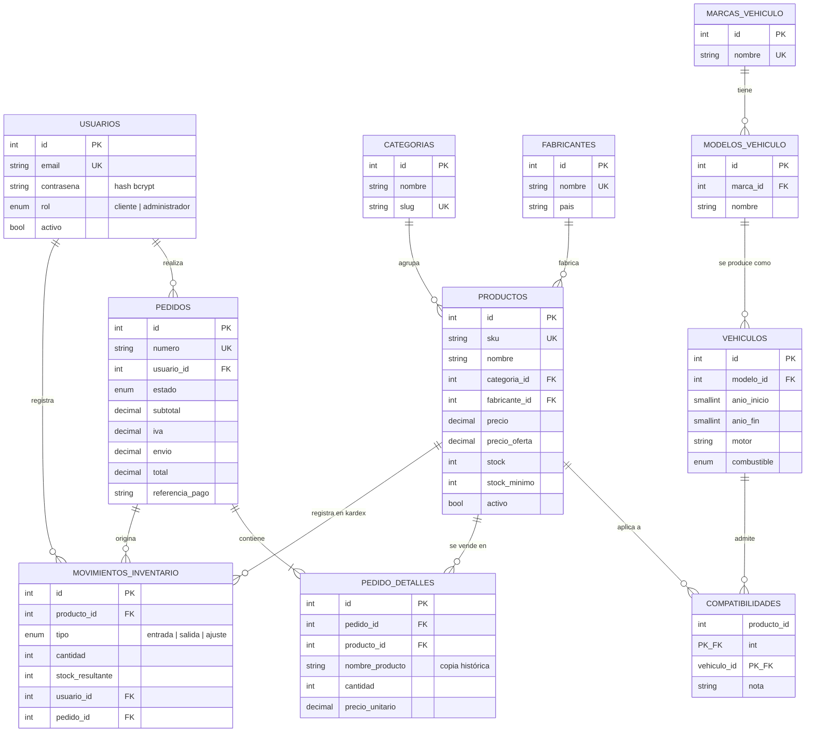
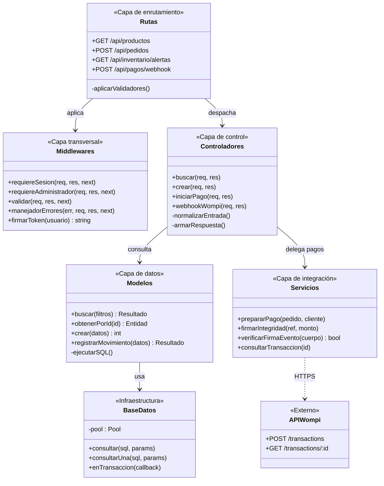
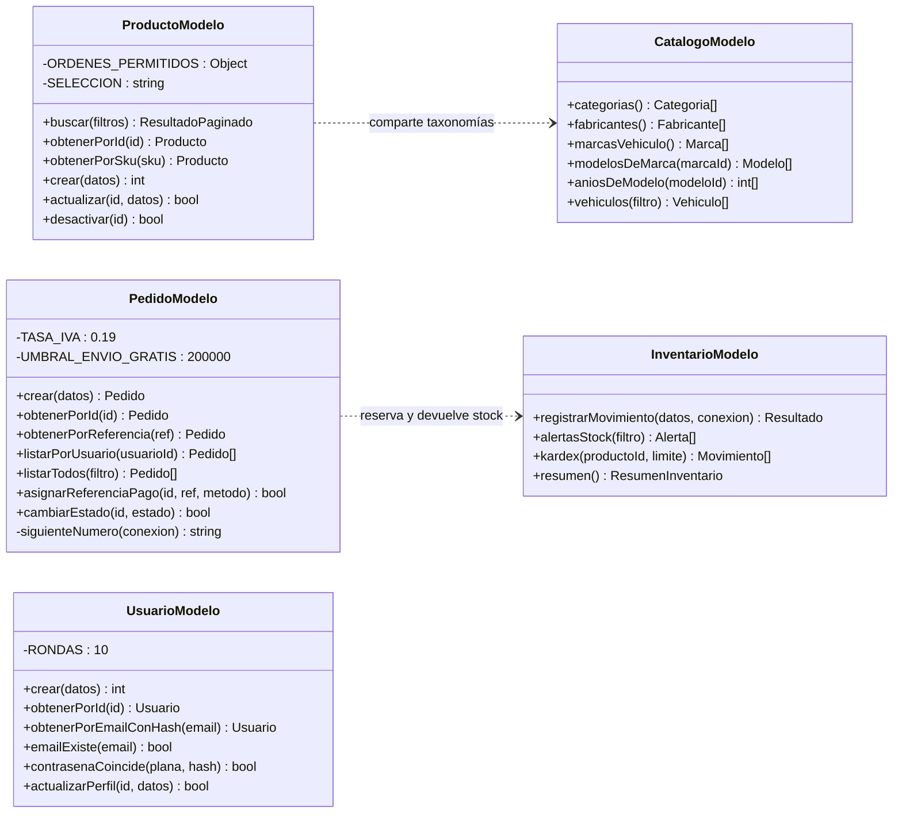
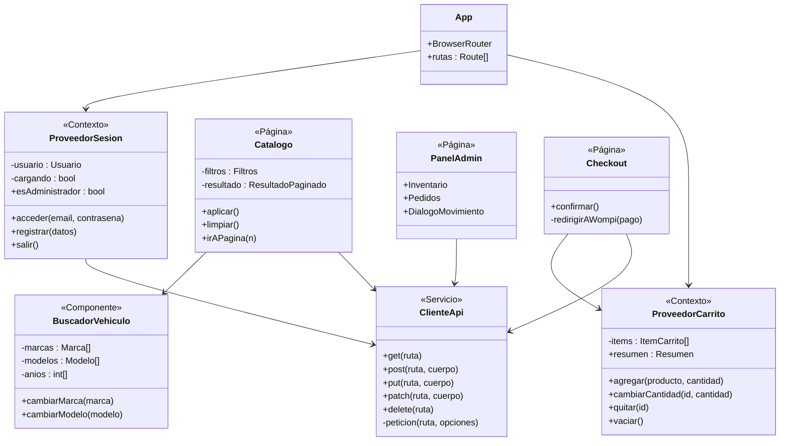
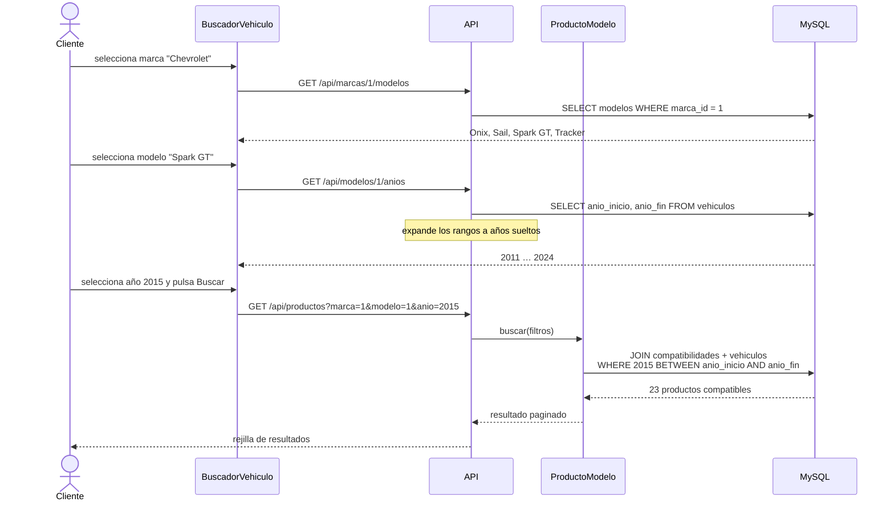
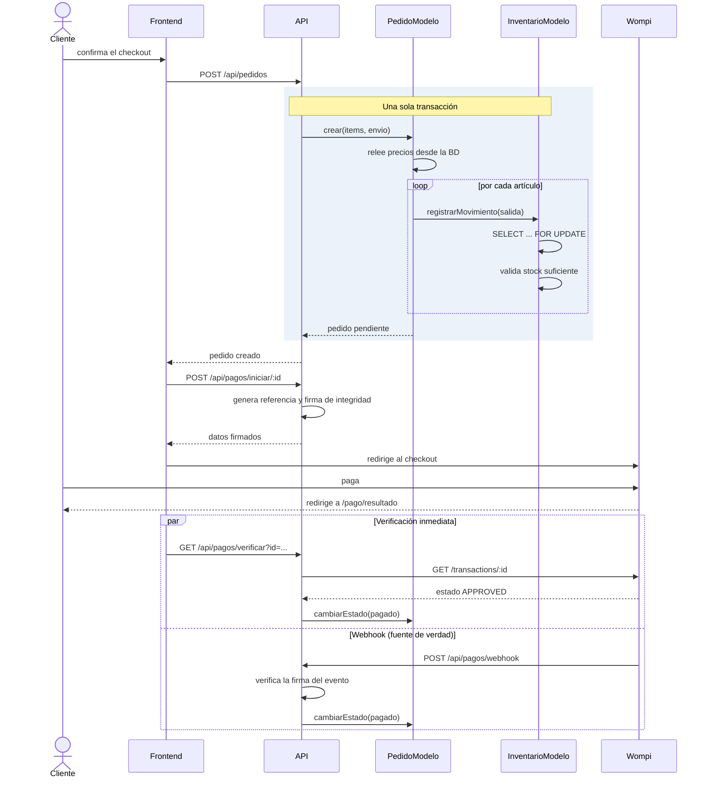
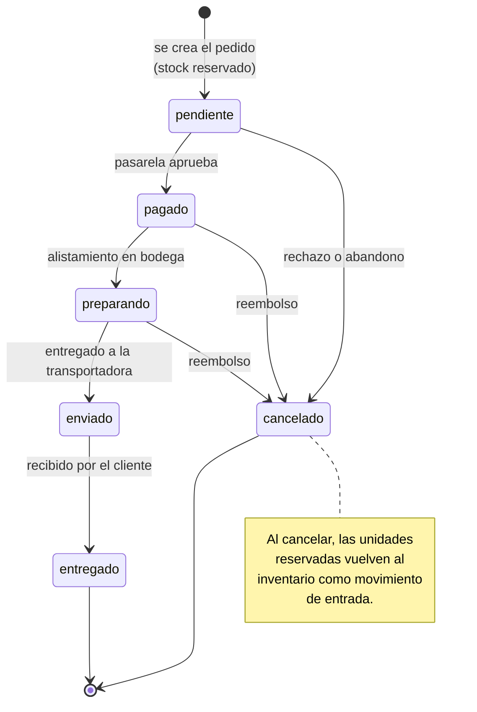

# Diagrama de clases — AutoPart Pro

Los diagramas están escritos en **Mermaid**. Se visualizan en GitHub, en
VS Code con la extensión *Markdown Preview Mermaid*, o pegándolos en
`https://mermaid.live`.

---

## 1. Modelo del dominio (entidad-relación)

Las entidades del negocio y cómo se relacionan.

**Lectura de la relación clave.** `PRODUCTOS` y `VEHICULOS` están en
muchos-a-muchos: un filtro de aceite sirve para veinte generaciones, y una
generación admite veinte repuestos distintos. `COMPATIBILIDADES` materializa
esa relación y es la tabla que recorre el buscador avanzado.

---

## 2. Arquitectura por capas (backend MVC)

**Regla que sostiene la arquitectura:** solo la capa de modelos escribe SQL.
Un controlador que construyera una consulta estaría saltándose la capa que
garantiza las transacciones y las consultas preparadas.

---

## 3. Clases del modelo de datos

**Dependencia destacada.** `PedidoModelo` llama a
`InventarioModelo.registrarMovimiento()` pasándole su propia conexión de
transacción. Así crear el pedido y descontar el stock ocurren dentro de la
misma transacción: si falla el tercer artículo, se revierten también los dos
primeros.

---

## 4. Componentes del frontend

---

## 5. Secuencia: búsqueda por vehículo

---

## 6. Secuencia: compra y pago

**Por qué dos caminos de confirmación.** La redirección es inmediata pero
frágil: si el cliente cierra el navegador, nunca llega. El webhook sale de
los servidores de Wompi y es independiente del navegador, pero puede tardar.
Atender ambos hace que el pedido se confirme por la vía que llegue primero;
`cambiarEstado` no hace nada si el estado ya es el correcto, así que el doble
aviso no causa efectos duplicados.

---

## 7. Máquina de estados del pedido

